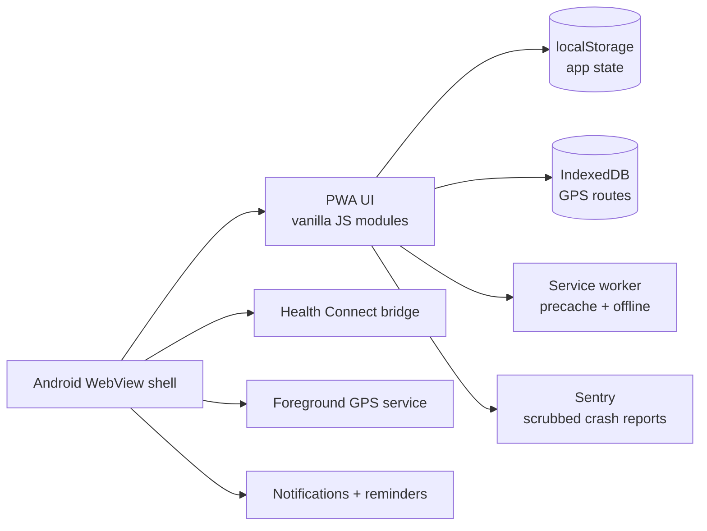

<p align="center">
  
</p>

<h1 align="center">openHybrid</h1>

<p align="center">
  Offline-first hybrid strength and running tracker.<br>
  Vanilla JavaScript PWA with a custom Android WebView shell.
</p>

> **Status: pre-release, local-first, open source.** openHybrid is licensed under the
> GNU Affero General Public License v3.0 (`AGPL-3.0-only`). There is no account
> system and no cloud sync: training data stays on the device, with JSON/CSV
> export and Android automatic backups for moving it. The hosted PWA is a
> preview of the same app.

## What it does

openHybrid is a training app for people who lift and run. It keeps the fast logging
workflow of a strength app while treating running, recovery and load as part of
the same training picture.

- **Decision-first Home** — a seven-day "This week" strip first, then a compact
  Today card for Start/Resume/Review, a bodyweight card with one-tap logging,
  one coach insight and quick actions. Deep charts stay in Progress; the old
  In Focus cards are gone.
- **Strength logging** — routines, set types, RPE/RIR, rest timers, supersets,
  exercise swaps, plate math, estimated 1RM and PRs. A 4,400+ exercise catalogue
  (openGym text, AGPL, no media) backs search and imports. An optional warm-up
  ramp adds editable 40/60/80% sets once you enter the first working weight.
- **Running** — manual entries, native GPS tracking with a route map, splits,
  FIT-file import and run analytics.
- **Recovery and load** — readiness, training load, ACWR and a weekly review.
  Progress → Muscle Load shows weekly volume, recovery and untrained muscles per
  muscle group.
- **Health Connect** (Android) — steps, resting heart rate, HRV and sleep, read
  only and field by field.
- **Bodyweight and fasting** — a Progress graph with daily weigh-ins, a 7-day
  average, weekly means, an optional goal line and a 21-day weekly-rate corridor.
  Weigh-ins open a prefilled sheet with ±0.1/±0.5/±1 steppers and recent entries,
  so the usual log is one tap. Plus fasting protocols.
- **Programs** — a catalogue of strength, hypertrophy, running and hybrid
  programmes, plus a program builder.
- **Offline-first** — the PWA precaches its runtime and keeps training data on
  the device. There is no account, server or cloud sync; JSON/CSV export and
  Android automatic backups move data deliberately.
- **Modules** — hide Running & GPS, Fasting, Health Connect or Recovery & Load
  from Settings → Modules. Hiding a module never deletes its data.
- **Equipment profiles** — keep separate kits for home and the commercial gym.
  Each profile stores its own bar weight, plate denominations and optional pairs
  owned, dumbbell ladder and machine stacks; the active profile drives program
  fit, exercise swaps and optional per-side plate hints. Hints say when a target
  cannot be built, and suggested loads snap to the weights you record. Switching
  takes one tap in Settings.
- **Themes & layout** — Midnight is the default icons-derived palette (navy,
  steel, cyan, lime); Slate, Forest and Ember are alternatives. Light keeps its
  own colours. Home and Progress let you hide optional cards and reset to the
  default without touching the data.
- **Bring your history** — import OpenGym, Strong or Hevy CSV files (strength
  sets, cardio runs and weigh-ins), or drop a batch of Garmin/Wahoo/Coros FIT
  activities into Settings. FIT runs keep date, distance, pace, HR and GPS;
  strength FIT files import time/HR only because the format has no exercise names.
- **Plans that move** — export any plan as a portable `.json` file and import it
  on another device. Discover is now one searchable list, while saved, completed
  and custom/imported plans live together under My Plans.
- **Correct saved workouts** — History lets you reopen a finished strength
  session or run and fix weights, reps, distance, HR or notes in place without
  changing its date or identity.
- **Progression styles** — custom programs can choose Double, Linear or Rep-first
  coaching. The suggested next load follows that program's style while keeping
  RPE, fatigue, cutting and stall safeguards.
- **Import and export your history** — bring workout history and bodyweight from
  OpenGym, Strong or Hevy CSV exports, or batch-import Garmin/Wahoo FIT files.
  Strength sets, cardio runs and weigh-ins all import. Export the full training
  log, a clean bodyweight CSV or a complete JSON backup. No account or server
  involved.
- **Durable on Android** — the shell mirrors the same state into app-private
  storage, so WebView eviction or a full localStorage quota does not lose the
  last change; a failed write is reported instead of silently claiming success.
- **Android shell** — bundled assets in a hardened WebView with native Health
  Connect, GPS and notification bridges.

## Tech stack

| Area | Choice |
| --- | --- |
| Web app | Vanilla JavaScript ES modules, no framework, no build step |
| Styling | Plain CSS with a shared visual system |
| Offline | Service worker + generated precache manifest |
| Local data | `localStorage` for app state, IndexedDB for GPS routes; Android adds an app-private atomic file mirror |
| Native | Kotlin Android WebView shell, `minSdk 26`, `targetSdk 36` |
| Verification | `node --test`, TypeScript checking of JSDoc-annotated JS, 34 Playwright browser checks |
| Runtime | Node.js 20+ for tooling |

## Architecture



The web app is the product. The Android project is a thin, hardened host that
loads the bundled web assets from a virtual HTTPS origin and exposes only the
native capabilities the web layer needs. The PWA and the APK share the same
allowlisted web root, staged by `scripts/stage-web-root.mjs`.

## Quick start

```bash
npm ci
npm run verify

# Real-browser checks need Chromium once:
npx playwright install chromium
npm run browser:verify

# Serve over HTTP — the service worker will not run from file://
python3 -m http.server 8770 --bind 127.0.0.1
```

Open <http://127.0.0.1:8770/>.

The first launch runs onboarding. No account is required. Use **Restore backup
file** for a openHybrid JSON export, or **Settings → Data → Import from Another App
(CSV)** for an OpenGym/Strong/Hevy workout or bodyweight export. All
logging works offline.

## Renaming from Helyx

The project is now **openHybrid**. This is a new Android application ID
(`com.mjb96.openhybrid`), so the renamed APK installs alongside Helyx rather
than upgrading it. The hosted PWA lives at <https://mjb96.github.io/openHybrid/>, and browser
storage is origin-scoped.

In both cases, move your data deliberately:

1. In Helyx, open **Settings → Data & backups** and export a JSON backup.
2. Install/open openHybrid (or open the new PWA URL).
3. Restore the JSON backup.

The internal state key (`hybrid_engine_v2_state`) is unchanged; it is a data
format, not branding.

## Verification

| Command | What it covers |
| --- | --- |
| `npm test` | Node unit tests |
| `npm run verify` | Type check, precache check, workflow gates, unit tests, smoke render |
| `npm run browser:verify` | 41 Playwright product checks (parallel, 180 s per-check kill with one timeout retry; `-- --serial` to debug) |
| `npm run perf:baseline` | Boot performance and bounded-DOM baseline |
| `npm run precache:gen` | Regenerate the service-worker precache manifest |

The browser suite covers navigation, logging, analytics, accessibility, touch
targets, safe areas, offline starts and performance. It is required in CI for
every pull request.

## Android build

The Android project is built in CI with JDK 17 and Gradle 8.13. The Gradle
wrapper is intentionally not committed; see
[`docs/versioning.md`](docs/versioning.md) for the one-time local setup.

```bash
# Stage only the production web assets into the APK.
node scripts/stage-web-root.mjs android/app/src/main/assets/www

# With Gradle 8.13 available:
cd android
gradle testDebugUnitTest lintDebug assembleDebug
```

## Project layout

| Path | Contents |
| --- | --- |
| `index.html` | Static shell, view containers and inline page styles |
| `js/` | Application modules; bootstrap is `js/app.js` |
| `css/` | Shared styles and feature styles |
| `sw.js` | Service worker; precache list is generated |
| `scripts/` | Precache generation, browser checks, staging, vendor scripts |
| `tests/` | Node unit and contract tests |
| `android/` | Kotlin WebView shell, native bridges and JVM tests |
| `docs/` | Architecture decisions, roadmap, security notes and legal drafts |

## Documentation

- [Improvement roadmap](docs/IMPROVEMENT_ROADMAP.md) — product direction and session log
- [Architecture decisions](docs/ARCHITECTURE_DECISIONS.md) — WebView and Android data-safety ADRs
- [WebView threat model](docs/security/webview-threat-model.md) — trust boundaries and bridge hardening
- [Versioning and toolchain](docs/versioning.md) — supported versions and release inputs

## Security and privacy

openHybrid handles health and location data. The app is local-first: training data
stays on the device, and exports/backups are the deliberate way to move it.
Crash reporting is error-only and scrubbed. The Android shell disables platform
backups and keeps the privileged WebView on a single bundled origin.

If you find a security issue, please follow [SECURITY.md](SECURITY.md). Do not
open a public issue containing exploit details, credentials or personal health
data.

## Known limitations

- The hosted PWA is a preview; Android is the primary offline target.
- There is no account system and no cloud sync. Moving data between devices is
  a JSON export/import or the Android automatic-backup folder.
- Workout CSV import covers strength sets and bodyweight. Cardio rows are
  skipped; there is no cardio import planned right now.
- There is no iOS project; iOS and billing are out of scope.
- The legal documents in `docs/legal/` are drafts with placeholders and are not
  legal advice.
- openHybrid provides general fitness information, not medical advice.

## License

Copyright (C) 2026 the openHybrid contributors.

openHybrid is free software: you can redistribute it and/or modify it under the
terms of the **GNU Affero General Public License, version 3 only**
(`AGPL-3.0-only`) as published by the Free Software Foundation.

openHybrid is distributed in the hope that it will be useful, but **WITHOUT ANY
WARRANTY**; without even the implied warranty of MERCHANTABILITY or FITNESS FOR
A PARTICULAR PURPOSE. See the [LICENSE](LICENSE) for the full text.

Third-party notices are in [NOTICE.md](NOTICE.md). The corresponding source for
the hosted PWA and the Android app is this repository:
<https://github.com/mjb96/openHybrid>.

If you run a modified version as a network service, the AGPL requires you to
offer its users the corresponding source. Contributions are accepted under the
same licence.

