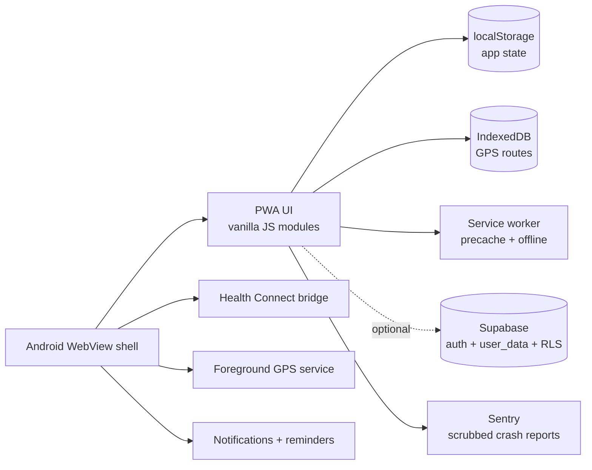

<p align="center">
  
</p>

<h1 align="center">Helyx</h1>

<p align="center">
  Offline-first hybrid strength and running tracker.<br>
  Vanilla JavaScript PWA with a custom Android WebView shell.
</p>

> **Status: pre-release.** The hosted PWA is not currently deployed and the
> Supabase backend is not provisioned, so sign-in and cloud sync are unavailable
> in this snapshot. The app runs in local-only mode. This repository is public
> for review and portfolio purposes and is not accepting contributions.

## What it does

Helyx is a training app for people who lift and run. It keeps the fast logging
workflow of a strength app while treating running, recovery and load as part of
the same training picture.

- **Strength logging** — routines, set types, RPE/RIR, rest timers, supersets,
  exercise swaps, plate math, estimated 1RM and PRs.
- **Running** — manual entries, native GPS tracking with a route map, splits,
  FIT-file import and run analytics.
- **Recovery and load** — readiness, training load, ACWR and a weekly review.
- **Health Connect** (Android) — steps, resting heart rate, HRV and sleep, read
  only and field by field.
- **Bodyweight and fasting** — trend tracking, calendar-window averages and
  fasting protocols.
- **Programs** — a catalogue of strength, hypertrophy, running and hybrid
  programmes, plus a program builder.
- **Offline-first** — the PWA precaches its runtime and keeps training data on
  the device; an optional Supabase account adds cross-device sync.
- **Durable on Android** — the shell mirrors the same state into app-private
  storage, so WebView eviction or a full localStorage quota does not lose the
  last change; a failed write is reported instead of silently claiming success.
- **Android shell** — bundled assets in a hardened WebView with native Health
  Connect, GPS and notification bridges.

## Tech stack

| Area | Choice |
| --- | --- |
| Web app | Vanilla JavaScript ES modules, no framework, no build step |
| Styling | Plain CSS with a shared visual system |
| Offline | Service worker + generated precache manifest |
| Local data | `localStorage` for app state, IndexedDB for GPS routes; Android adds an app-private atomic file mirror |
| Cloud (optional) | Supabase Auth + one `user_data` row per user, protected by RLS |
| Native | Kotlin Android WebView shell, `minSdk 26`, `targetSdk 36` |
| Verification | `node --test`, TypeScript checking of JSDoc-annotated JS, 32 Playwright browser checks |
| Runtime | Node.js 20+ for tooling |

## Architecture



The web app is the product. The Android project is a thin, hardened host that
loads the bundled web assets from a virtual HTTPS origin and exposes only the
native capabilities the web layer needs. The PWA and the APK share the same
allowlisted web root, staged by `scripts/stage-web-root.mjs`.

## Quick start

```bash
npm ci
npm run verify

# Real-browser checks need Chromium once:
npx playwright install chromium
npm run browser:verify

# Serve over HTTP — the service worker will not run from file://
python3 -m http.server 8770 --bind 127.0.0.1
```

Open <http://127.0.0.1:8770/>.

The first launch runs onboarding. No account is required; without one, data
stays in the browser. The cloud UI is present but the backend must be
provisioned before sign-in works.

## Verification

| Command | What it covers |
| --- | --- |
| `npm test` | Node unit tests |
| `npm run verify` | Type check, precache check, workflow gates, unit tests, smoke render |
| `npm run browser:verify` | 32 Playwright product checks |
| `npm run perf:baseline` | Boot performance and bounded-DOM baseline |
| `npm run precache:gen` | Regenerate the service-worker precache manifest |

The browser suite covers navigation, logging, analytics, accessibility, touch
targets, safe areas, offline starts and performance. It is required in CI for
every pull request.

## Android build

The Android project is built in CI with JDK 17 and Gradle 8.13. The Gradle
wrapper is intentionally not committed; see
[`docs/versioning.md`](docs/versioning.md) for the one-time local setup.

```bash
# Stage only the production web assets into the APK.
node scripts/stage-web-root.mjs android/app/src/main/assets/www

# With Gradle 8.13 available:
cd android
gradle testDebugUnitTest lintDebug assembleDebug
```

## Project layout

| Path | Contents |
| --- | --- |
| `index.html` | Static shell, view containers and inline page styles |
| `js/` | Application modules; bootstrap is `js/app.js` |
| `css/` | Shared styles and feature styles |
| `sw.js` | Service worker; precache list is generated |
| `scripts/` | Precache generation, browser checks, staging, vendor scripts |
| `tests/` | Node unit and contract tests |
| `android/` | Kotlin WebView shell, native bridges and JVM tests |
| `supabase/` | RLS SQL, `updated_at` trigger and the account-deletion function |
| `docs/` | Architecture decisions, roadmap, security notes and legal drafts |

## Documentation

- [Improvement roadmap](docs/IMPROVEMENT_ROADMAP.md) — product direction and session log
- [Architecture decisions](docs/ARCHITECTURE_DECISIONS.md) — WebView and Android data-safety ADRs
- [WebView threat model](docs/security/webview-threat-model.md) — trust boundaries and bridge hardening
- [Versioning and toolchain](docs/versioning.md) — supported versions and release inputs
- [Supabase setup](supabase/README.md) — RLS and the adversarial isolation proof

## Security and privacy

Helyx handles health and location data. The app is local-first: data is only
sent to Supabase when the user signs in, and crash reporting is error-only and
scrubbed. The Android shell disables platform backups and keeps the privileged
WebView on a single bundled origin.

If you find a security issue, please follow [SECURITY.md](SECURITY.md). Do not
open a public issue containing exploit details, credentials or personal health
data.

## Known limitations

- The hosted PWA and Supabase backend are not provisioned in this snapshot.
- Cloud sync stores one JSON blob per user with last-write-wins and a conflict
  prompt, not field-level merging.
- There is no iOS project; iOS and billing are out of scope.
- Email/password auth exists, but there is no password-reset flow yet.
- The legal documents in `docs/legal/` are drafts with placeholders and are not
  legal advice.
- Helyx provides general fitness information, not medical advice.

## License

All rights reserved. This source is published for viewing and evaluation only;
see [LICENSE](LICENSE). No open-source license is granted.
